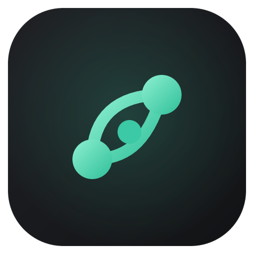
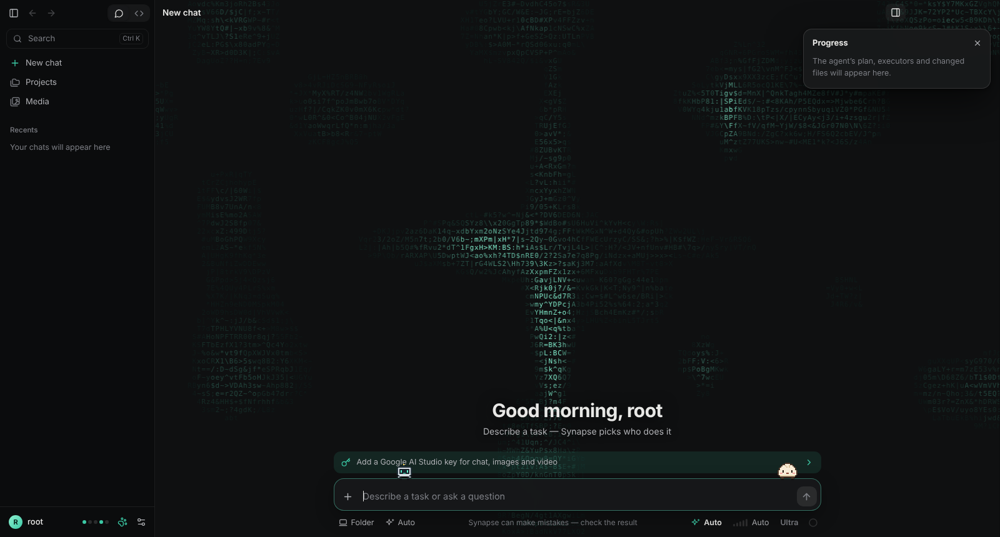
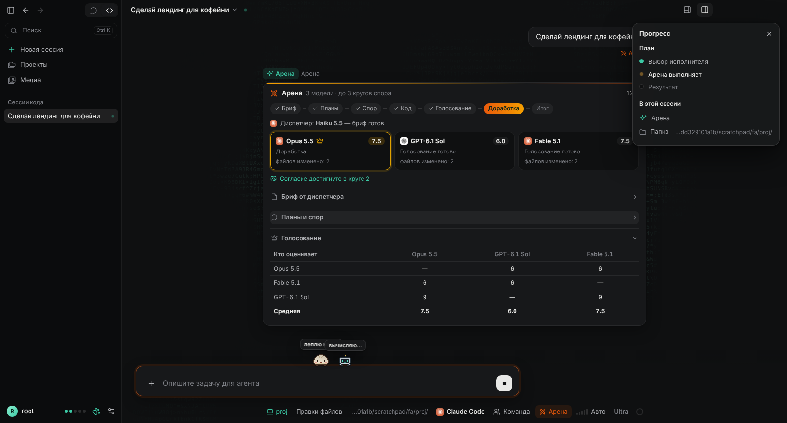
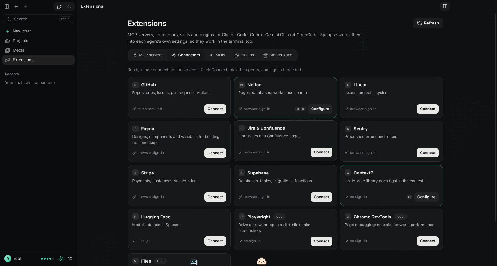
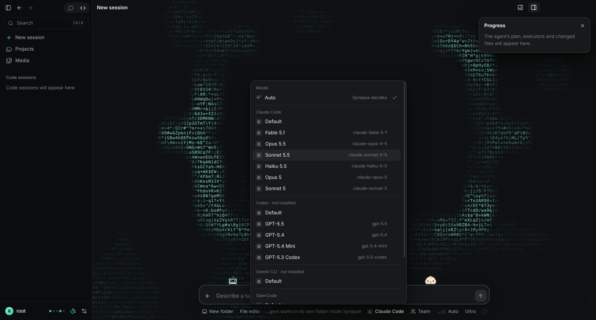
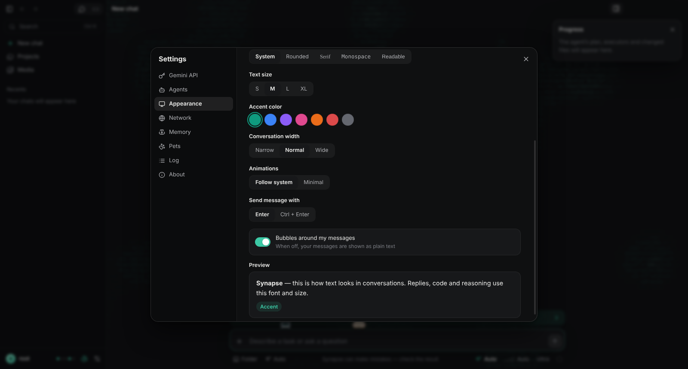
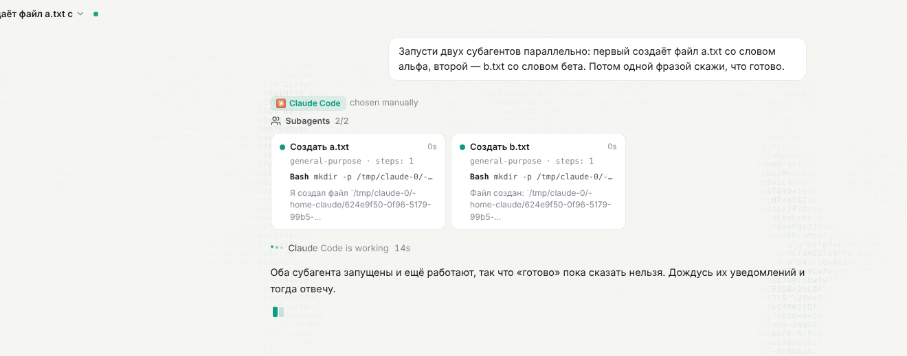
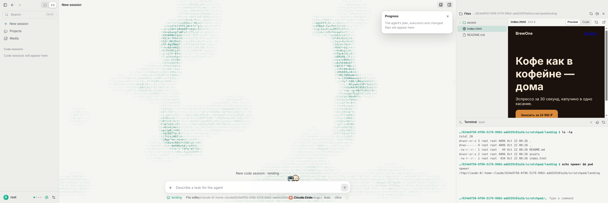

<div align="center">



# Synapse

### A new gen of vibecode.

One desktop app. Every AI you already pay for. Describe the task, and Synapse decides who does it.

[](LICENSE)
[](#install)
[](https://www.electronjs.org/)
[](https://github.com/wsq4kar/synapse/releases)

**English** · [Русский](README.ru.md)



</div>

---

## Why Synapse

You have a Claude subscription, a ChatGPT subscription and a Gemini key. Each one comes with its own app, its own limits and its own tabs. Synapse puts all of them behind **one input box**:

- **Code and files** go to a real coding agent running on your machine: **Claude Code**, **Codex**, **Antigravity CLI** or **OpenCode**. It runs under your own login, so it uses your subscriptions and costs nothing extra.
- **Chat, images and video** go to the **Gemini API** (Gemini, Nano Banana, Veo) or to **OpenRouter** — hundreds of models with one key.
- If one agent hits its limit or fails, the task **falls through to the next one** automatically.

Everything stays local. Your chats, settings and keys stay on your computer, and there is no Synapse server.

## Features

<table>
<tr>
<td width="50%" valign="top">

### Smart routing
Synapse reads the task and picks the executor. Coding goes to an agent, a question goes to chat, "draw" goes to images, "animate" goes to video. You can also pick the agent and the exact model by hand.

### Four coding agents
**Claude Code**, **Codex**, **Antigravity CLI** and **OpenCode**, each with its real models (Opus, Sonnet, GPT-5.x, Gemini, DeepSeek, GLM and more), a fallback order you set yourself, and session resume.

### Arena
Turn on **Arena** in the Code tab and the large models work as a team. A small model writes the brief, then Opus, GPT-6 and Gemini plan, debate (up to 3 rounds, or until they agree), each build their own variant in a separate copy of your folder, and vote anonymously for the best one. The winner fixes what the others found, and you apply the result with one button.

### Extensions
One page for **MCP servers, connectors, skills and plugins** across all four agents. Turn a server on for Claude Code, Codex, Antigravity or OpenCode with one click, connect GitHub, Notion, Linear, Figma, Jira, Sentry, Stripe or Supabase in a couple of clicks, write skills in a built-in editor, and install Claude Code plugins from marketplaces or MCP servers from the official MCP registry. Everything is written into each agent's own config, so it works in the terminal too.

### Subagents and Team mode
One request can spawn parallel subagents, each with its own live card, steps and result.

### Visible reasoning
You see the model think in real time and can expand the summary afterwards. Text streams in smoothly with per-word reveal animations.

</td>
<td width="50%" valign="top">

### Workspace
A file tree, an instant preview (HTML, code, Markdown, PDF, images, video) and a built-in **PowerShell terminal**, all next to the chat. Hide the file list or expand the preview when you need the room.

### Tokens and limits
Context fill, new tokens versus cache reuse, plus your **Claude and Codex subscription limits** (5-hour and weekly) in one popover.

### Network control
System, HTTP proxy or SSH tunnel. A strict mode where AIs reach the internet *only* through your proxy, plus optional Windows Firewall rules.

### Made to be lived in
Light and dark themes, five font styles, text size, accent colors, conversation width, Ultra mode, effort levels, an ASCII background, little pets that live on your input box, and RU/EN.

</td>
</tr>
</table>

## Screenshots

<p align="center"><br><sub><b>Arena:</b> large models plan, debate, build and vote. The best variant wins.</sub></p>

<p align="center"><br><sub><b>Extensions:</b> MCP servers, connectors, skills, plugins and marketplaces for every agent</sub></p>

<table>
<tr>
<td><br><sub><b>Model picker:</b> every agent and every model in one menu</sub></td>
<td><br><sub><b>Appearance:</b> font, size, accent, width, motion</sub></td>
</tr>
<tr>
<td><br><sub><b>Subagents:</b> parallel workers with live progress</sub></td>
<td><br><sub><b>Workspace:</b> files, live preview and terminal</sub></td>
</tr>
</table>

## Install

1. Download `Synapse-Setup-x.y.z.exe` from **[Releases](https://github.com/wsq4kar/synapse/releases)**.
2. Run it and choose a language. No admin rights are needed.
3. The installer is not code-signed, so Windows SmartScreen may warn you. Click **More info**, then **Run anyway**.

## Quick start

| Step | Where | What |
|---|---|---|
| 1 | **Settings → API keys** | Paste a key from [Google AI Studio](https://aistudio.google.com/apikey) and/or [OpenRouter](https://openrouter.ai/keys). Models are picked automatically. |
| 2 | **Settings → Agents** | Install at least one CLI agent (see below), sign in, then press **Check again**. |
| 3 | Main screen | Type a task. Use `Ctrl+2` for a code session in a folder, `Ctrl+U` for Ultra and `Ctrl+E` for effort. |

### Coding agents

| Agent | Install | Sign in | Uses |
|---|---|---|---|
| **Claude Code** | `npm i -g @anthropic-ai/claude-code` | `claude auth login` | Claude Pro / Max subscription |
| **Codex** | `npm i -g @openai/codex` | `codex login` | ChatGPT Plus / Pro subscription |
| **Antigravity CLI** | `irm https://antigravity.google/cli/install.ps1 \| iex` (PowerShell) | run `agy` once | Google account (Gemini, Claude and GPT-OSS models) |
| **OpenCode** | `npm i -g opencode-ai` | `opencode auth login` (optional) | Any provider, including **free** OpenCode Zen models |

Synapse finds them in the usual places. If one isn't found, point to the file or folder in **Settings → Agents**.

If Antigravity is blocked in your region, [AGUnlocker](https://github.com/confeden/Antigravity) works with Synapse out of the box: when it is installed, `agy` is routed through it instead of the Synapse proxy.

You don't have to type model names: Synapse reads them from [`src/main/models.json`](src/main/models.json) and pulls a fresh copy of that file from GitHub. Antigravity also reports its own models (`agy models`).

## Privacy and security

- **No Synapse backend.** The app talks directly to Google, Anthropic, OpenAI and the other providers, or to your agents' CLIs.
- **Your Gemini key** is encrypted with Windows DPAPI (Electron `safeStorage`) and never leaves your PC except in requests to Google.
- **Agents run under your login** in a folder you choose. By default they may only edit files; *Full access* is an explicit switch.
- Data lives in `%APPDATA%\Synapse\data`, and agent workspaces default to `Documents\Synapse`.

## Build from source

```bash
git clone https://github.com/wsq4kar/synapse.git
cd synapse
npm install
npm start                 # run in development
node scripts/check.js     # syntax check for all scripts
npm run dist              # build the Windows installer (on Windows)
```

Pushing a tag like `v0.1.10` builds the installer on GitHub Actions and attaches it to a release.

<details>
<summary><b>Project layout</b></summary>

```
src/
  main/                 Electron main process
    main.js             window, IPC, task runner, routing to executors
    router.js           heuristic + Gemini classification of tasks
    executors/cli.js    Claude Code / Codex / Antigravity CLI / OpenCode runners and stream parsers
    executors/gemini.js Gemini API: chat (streaming, thoughts), images, video
    executors/openrouter.js OpenRouter: chat, routing, images, model list
    models.json         model lists for agents, OpenRouter and the Arena
    catalog.js          reads models.json and updates it from GitHub
    tokens.js           history budgets that save tokens
    netproxy.js         system / HTTP proxy / SSH network modes
    tunnel.js           SSH SOCKS tunnel
    firewall.js         Windows Firewall rules for strict mode
    workspace.js        file tree, preview protocol, PowerShell terminal
    codexlimits.js      Codex subscription limits via `codex app-server`
    store.js            settings, chats, encrypted key
  renderer/             UI: app.js, workbench.js, styles.css, i18n.js, pets.js, ascii.js
build/                  icons, NSIS installer script
```

</details>

## How the Arena works

| Stage | Who | What happens |
|---|---|---|
| Brief | small model (Haiku 5.5, GPT-5.6 Luna…) | reads the project and turns your request into goals and acceptance criteria |
| Plans | every large model | proposes an approach in its own copy of the folder |
| Debate | every large model | reads the other plans, criticises them, improves its own, says "agree" or "object"; stops early on consensus |
| Build | every large model, `xhigh` effort (`max` with Ultra) | implements its plan in its own copy |
| Vote | every large model | scores the other variants 1–10 anonymously and lists fixes |
| Polish | the winner | fixes what the reviewers found |
| Result | you | see scores and the diff; **Apply** copies the files into your folder, or pick another variant |

Your folder is untouched until you press **Apply**, and Synapse warns you if files changed in the meantime. The line-up is picked automatically from the installed agents (one strongest model per agent, then the next strongest), and you can change it in **Settings → Agents → Arena**. Running several large models costs several times more of your limits than a normal request.

## Roadmap

- [ ] Voice input
- [ ] `/` slash commands in the composer
- [ ] Side-by-side answers from two agents
- [ ] File history with one-click rollback
- [ ] macOS build

Ideas and bug reports are welcome in [Issues](https://github.com/wsq4kar/synapse/issues).

## Contributing

Pull requests are welcome. Before opening one:

1. Run `node scripts/check.js`.
2. Check your change in the app with `npm start`.
3. Add any new UI strings to `src/renderer/i18n.js` (Russian is the key, English is the value).

## License

[GPL-3.0](LICENSE). You may use, study, change and share Synapse. Any app built on this code must also be open-source under GPL-3.0.

<div align="center"><sub>Made by <a href="https://github.com/wsq4kar">wsq4kar</a> · Claude, Codex, Gemini and OpenCode are trademarks of their respective owners. Synapse is not affiliated with them.</sub></div>
